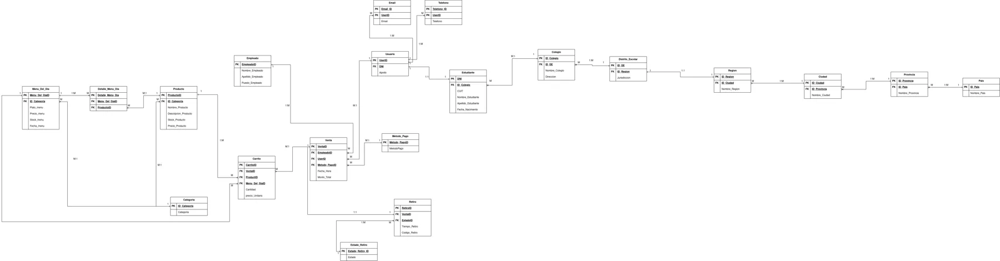

# 1. Alcance

Este manual describe cómo está construido **El Buffet de Alejandro**, cómo instalarlo y compilarlo, y cómo mantenerlo. Está dirigido a quien tenga que instalar el sistema en el buffet, corregir un error o agregar una funcionalidad.

El sistema tiene dos partes:

| Parte | Tecnología | Ubicación en el repositorio |
|---|---|---|
| Aplicación de escritorio | C++17, Qt 6 (Widgets), CMake | `app/` y `CMakeLists.txt` |
| Base de datos | MySQL 8.0: 3 schemas, 27 tablas, 27 stored procedures | `database/` |

Las reglas de cada pantalla están en `docs/validaciones_sistema.md` y el uso de cada pantalla en `docs/manual-usuario.md`.

# 2. Arquitectura

```text
 ┌──────────────────────────────────────────────────────────────────────┐
 │  PRESENTACIÓN (Qt Widgets, archivos .ui + .cpp)                      │
 │  LoginWindow · RegisterDialog · MainWindow · ProductDetailDialog     │
 │  CarritoDialog · PagoDialog · ComprobanteDialog · PerfilDialog       │
 │  CajeroWindow · AdminWindow · DevWindow                              │
 └───────────────┬──────────────────────────────────────────────────────┘
                 │ lee y escribe
 ┌───────────────▼──────────────────────────────────────────────────────┐
 │  ESTADO COMPARTIDO: SistemaBuffet (miembros static)                  │
 │  usuario activo · carrito · stock y precios · menú de hoy · pedidos  │
 │  conexión MYSQL* conn (NULL = modo sin conexión con datos en memoria)│
 └───────────────┬──────────────────────────────────────────────────────┘
                 │ llama
 ┌───────────────▼──────────────────────────────────────────────────────┐
 │  ACCESO A DATOS: basedatos.cpp (API de C de MySQL, libmysql)         │
 │  conectar_bdd · ejecutar_consulta · texto_sql · error_del_sp         │
 │  una función por stored procedure (CALL ...) y 3 SELECT de lectura   │
 └───────────────┬──────────────────────────────────────────────────────┘
                 │ TCP 127.0.0.1:3306
 ┌───────────────▼──────────────────────────────────────────────────────┐
 │  MySQL 8.0                                                           │
 │  schema_geografia (6) · schema_usuarios (11) · schema_comercial (10) │
 │  27 stored procedures: lógica de negocio, control de stock y log     │
 └──────────────────────────────────────────────────────────────────────┘
```

**Decisiones de diseño:**

- **La lógica crítica vive en la base de datos.** Los stored procedures controlan el stock, descuentan y devuelven el saldo, impiden cambiar un pedido ya cerrado y escriben la auditoría. La aplicación valida el formato de los datos antes de llamar al SP, pero la última palabra la tiene MySQL.
- **API de C de MySQL** (`mysql.h`), como en el material de la materia ("Conectar un gestor de BBDD al lenguaje C"). Los módulos `Qt Sql` se enlazan en CMake pero las consultas no pasan por `QSqlDatabase`.
- **Modo sin conexión.** Si `conectar_bdd()` devuelve `NULL`, la aplicación avisa y trabaja con una copia de los datos de `04_DatosSQL` cargada en listas paralelas de `SistemaBuffet`. Aplica las mismas reglas, pero nada se guarda. Sirve para demostrar la interfaz sin servidor.
- **Sin `struct`.** Por consigna de la materia, los datos en memoria se guardan en listas paralelas (`QStringList`, `QList<int>`, `QList<double>`) indexadas por posición.

# 3. Requisitos

| Componente | Versión | Notas |
|---|---|---|
| Sistema operativo | Windows 10 u 11, 64 bits | El `CMakeLists.txt` apunta a las rutas de MySQL en Windows |
| Qt | 6.x con los módulos Widgets y Sql | Se probó con el kit *Desktop Qt 6 MinGW 64-bit* |
| Qt Creator | El que trae el instalador de Qt | También se puede compilar con CMake desde la terminal |
| CMake | 3.16 o superior | |
| MySQL Community Server | 8.0 | Instalado en `C:/Program Files/MySQL/MySQL Server 8.0` |
| MySQL Workbench | Opcional | Para ejecutar los scripts y consultar los datos |
| Hardware | 4 GB de RAM, 1 GB libre en disco, pantalla de 1366 × 768 o más | |

# 4. Instalación

## 4.1 Base de datos

1. Instalar MySQL Server 8.0 y dejar el servicio corriendo en `localhost:3306`.
2. Ejecutar los scripts **en orden** (desde la consola o abriéndolos completos en Workbench):

```bash
mysql -u root -p < database/03_ModeloSQL_GrupoNoguera_SanMartin.sql
```

```bash
mysql -u root -p < database/04_DatosSQL_GrupoNogueraSanMartin.sql
```

```bash
mysql -u root -p < database/05_Backend_GrupoNoguera_SanMartin.sql
```

```bash
mysql -u root -p --force < database/06_PruebasSQL_GrupoNoguera_SanMartin.sql
```

| Script | Qué hace |
|---|---|
| `03_ModeloSQL` | Borra y vuelve a crear los 3 schemas y las 27 tablas con sus claves y `CHECK` |
| `04_DatosSQL` | Carga los catálogos y los datos de ejemplo (20 estudiantes con usuario, personal, productos, menús, 50 ventas y retiros) |
| `05_Backend` | Crea los 27 stored procedures (16 funcionalidades, 8 reportes, 1 de auditoría y 2 reportes tuneados) |
| `06_PruebasSQL` | Ejecuta las 28 pruebas (4 casos cada una). Lleva `--force` porque varios casos esperan un error a propósito |

**Atención:** `03` empieza con `DROP DATABASE IF EXISTS` sobre los tres schemas. Ejecutarlo en una instalación con datos reales **borra todo**. Hacer antes un respaldo:

```bash
mysqldump -u root -p --routines --databases schema_geografia schema_usuarios schema_comercial > respaldo.sql
```

El `06` agrega datos de prueba (un estudiante "Tomás Prueba", ventas, cargas de saldo). Para una instalación en producción, ejecutar solo `03`, `04` y `05`.

## 4.2 Aplicación

1. Abrir `CMakeLists.txt` con Qt Creator y elegir el kit de Qt 6 de 64 bits.
2. Revisar las credenciales de MySQL en `app/basedatos.cpp` (sección 4.3).
3. Compilar (Ctrl+B) y ejecutar (Ctrl+R).

Desde la terminal:

```bash
cmake -S . -B build
```

```bash
cmake --build build
```

Al terminar de compilar, CMake copia al lado del `.exe` las tres DLL que necesita la librería de MySQL: `libmysql.dll`, `libssl-3-x64.dll` y `libcrypto-3-x64.dll`. Para distribuir la aplicación en otra computadora hay que llevar también las DLL de Qt, con:

```bash
windeployqt build/ElBuffetDeAlejandro.exe
```

Si MySQL está instalado en otra carpeta, cambiar `MYSQL_DIR` en `CMakeLists.txt`.

## 4.3 Configuración de la conexión

Los datos del servidor están en `app/basedatos.cpp` como macros:

| Macro | Valor por defecto |
|---|---|
| `BDD_SERVIDOR` | `"127.0.0.1"` |
| `BDD_USUARIO` | `"root"` |
| `BDD_CLAVE` | `"12341234"` |
| `BDD_PUERTO` | `3306` |

Como cada macro está dentro de un `#ifndef`, se puede cambiar sin tocar el código, agregando en `CMakeLists.txt`:

```cmake
target_compile_definitions(ElBuffetDeAlejandro PRIVATE BDD_CLAVE="otra_clave")
```

La conexión se abre en `main.cpp` al arrancar, con `schema_comercial` como schema por defecto y el juego de caracteres `utf8mb4` (sin eso los acentos y la ñ llegan mal). Se cierra con `mysql_close` al salir.

# 5. Estructura del código

| Archivo | Clase o contenido | Responsabilidad |
|---|---|---|
| `main.cpp` | `main` | Hoja de estilos global (crema y bordó), conexión a MySQL y ventana de inicio |
| `basedatos.h/.cpp` | Funciones libres | Conexión, ejecución de consultas, escape de textos y una función por SP |
| `sistemabuffet.h/.cpp` | `SistemaBuffet` (todo `static`) | Estado compartido entre ventanas y datos de ejemplo del modo sin conexión |
| `loginwindow` | `LoginWindow` | Inicio de sesión de los 4 perfiles, límite de 3 intentos |
| `registerdialog` | `RegisterDialog` | Alta de usuario para un DNI de estudiante o profesor |
| `mainwindow` | `MainWindow` | Catálogo por pestañas, menú del día, botón del pedido, perfil y salida |
| `productdetaildialog` | `ProductDetailDialog` | Detalle del producto y cantidad (tope de 10 y de stock) |
| `carritodialog` | `CarritoDialog` | Tabla del carrito: cambiar cantidades, quitar y vaciar |
| `pagodialog` | `PagoDialog` | Datos, horario de retiro, método de pago, código y transacción del pedido |
| `comprobantedialog` | `ComprobanteDialog` | Muestra el código de retiro y el resumen |
| `perfildialog` | `PerfilDialog` | Saldo, carga de saldo e historial de pedidos |
| `cajerowindow` | `CajeroWindow` | Búsqueda por código, entrega y cancelación |
| `adminwindow` | `AdminWindow` | ABM de productos y auditoría |
| `devwindow` | `DevWindow` | Explorador y ejecución de SP, pruebas y acceso a las otras vistas |
| `recursos.qrc` | Recursos | Embebe `05_Backend` y `06_PruebasSQL` (prefijo `/bdd`) y las fotos (prefijo `/imagenes`) |

Cada ventana tiene su `.ui` (diseño en Qt Designer), su `.h` y su `.cpp`. Los eventos usan la conexión automática de slots por nombre (`on_<objeto>_<señal>`), y en `LoginWindow` se conecta además `returnPressed` de cada campo con el botón de inicio de sesión.

## 5.1 Navegación entre ventanas

```text
LoginWindow ──(Registrarme)──► RegisterDialog
    │
    ├─ Alumno o profesor ──► MainWindow ──► ProductDetailDialog
    │                            ├──► CarritoDialog ──► PagoDialog ──► ComprobanteDialog
    │                            └──► PerfilDialog
    ├─ Personal de caja ───► CajeroWindow
    ├─ Administrador ──────► AdminWindow
    └─ Desarrollador ──────► DevWindow ──► MainWindow / CajeroWindow / AdminWindow
```

Las ventanas principales se crean con `new` y se cierran con `close()` al pasar de una a otra. Los diálogos son modales (`exec()`). **SALIR** llama a `SistemaBuffet::cerrarSesion()` (que ejecuta `sp_cerrar_sesion`) y vuelve a crear `LoginWindow`.

## 5.2 Estado compartido (`SistemaBuffet`)

| Grupo | Miembros | Origen con conexión |
|---|---|---|
| Usuario activo | `usuarioID`, `usuarioRol`, `usuarioNombre`, `usuarioApellido`, `usuarioCurso`, `usuarioDni`, `usuarioSaldo` | `cargarUsuarioDesdeBDD()` con `obtener_datos_usuario` |
| Carrito | `carritoIds`, `carritoNombres`, `carritoPrecios`, `carritoCantidades` | Solo en memoria hasta pagar |
| Productos | `productosStock`, `productosPrecios` (la posición es el `ProductoID`; la 0 es el menú del día) | `cargarDesdeBDD()` con `obtener_productos` |
| Menú de hoy | `menuHoyID`, `menuHoyPlato`, `menuHoyIncluye`, `menuHoyPrecio` | `cargarMenuDelDia()` con `sp_menu_del_dia` |
| Pedidos | `pedidosRetiroIds`, `pedidosCodigos`, `pedidosAlumnos`, `pedidosEstados`, `pedidosDetalles` y otros | `cargarDesdeBDD()` con `obtener_pedidos` |

Un producto **Inactivo** se carga con stock 0, así no se puede agregar al carrito. `cargarDesdeBDD()` se vuelve a llamar al abrir el catálogo, después de cada compra, al abrir el perfil y en el mostrador después de cada cambio de estado.

# 6. Capa de acceso a datos

## 6.1 Funciones base

| Función | Qué hace |
|---|---|
| `conectar_bdd()` | `mysql_init` + `mysql_real_connect`. Devuelve `NULL` si falla y escribe el error en la consola |
| `ejecutar_consulta(conn, sql)` | `mysql_query` + `mysql_store_result`. Después recorre con `mysql_next_result` los resultados extra que deja todo `CALL`; si no se leen, la siguiente consulta falla con *Commands out of sync* |
| `texto_sql(conn, valor)` | Escapa el texto con `mysql_real_escape_string`. **Todo texto que escribe el usuario pasa por acá** antes de armar el `CALL`, para evitar inyección SQL |
| `valor_fila(fila, columna)` | Convierte una celda a `QString` en UTF-8; un `NULL` se devuelve como texto vacío |
| `error_del_sp(result)` | Si la primera columna se llama `estado`, el SP cayó en su `EXIT HANDLER`: devuelve el `codigo_sql` (por ejemplo 1062 o 1452). Si no, devuelve 0. Deja el cursor otra vez en la primera fila |

## 6.2 Convención de los stored procedures

Todos los SP de funcionalidad tienen la misma estructura:

```sql
DECLARE EXIT HANDLER FOR SQLEXCEPTION
BEGIN
    GET DIAGNOSTICS CONDITION 1 codigo_error = MYSQL_ERRNO, mensaje_error = MESSAGE_TEXT;
    SELECT 'ERROR' AS estado, codigo_error AS codigo_sql, mensaje_error AS descripcion_error;
END;
-- operación (INSERT / UPDATE) con sus condiciones en el WHERE
-- INSERT INTO schema_usuarios.Log_Auditoria ...
-- SELECT con Filas_Actualizadas (o el registro creado) como resultado
```

Así la aplicación distingue tres casos: **error** (columna `estado`), **sin efecto** (`Filas_Actualizadas = 0`, por ejemplo stock insuficiente o pedido ya entregado) y **éxito** (1 fila). Los errores que la aplicación traduce a mensajes son:

| Código MySQL | Dónde | Mensaje en la aplicación |
|---|---|---|
| 1452 (clave foránea) | `sp_registrar_usuario` | "Ese DNI no corresponde a un estudiante ni a un profesor" |
| 1062 (UNIQUE) en `Apodo` | `sp_registrar_usuario` | "Ese apodo ya existe" |
| 1062 (UNIQUE) en `DNI` | `sp_registrar_usuario` | "Ese DNI ya tiene una cuenta" |
| 1062 (UNIQUE) en `Codigo_Retiro` | `sp_generar_retiro` | Ninguno: se sortea otro código y se reintenta |

## 6.3 Transacción del pedido

`PagoDialog::guardarPedidoEnBDD()` guarda el pedido en tres pasos dentro de una transacción. Si cualquiera falla, un `ROLLBACK` deshace la venta y el stock ya descontado:

```text
START TRANSACTION
 1. sp_registrar_venta(UserID, NULL, Metodo_PagoID)        → VentaID
 2. por cada ítem del carrito:
      id 0  → sp_agregar_menu_carrito(VentaID, menuHoyID, cantidad)
      otro  → sp_agregar_producto_carrito(VentaID, ProductoID, cantidad)
    (cada SP descuenta stock solo si alcanza; 0 filas = sin stock → ROLLBACK)
 3. sp_generar_retiro(VentaID, ID_Franja, Codigo)          → 1 fila
    (si el método es 21, el SP descuenta el saldo solo si alcanza)
    error 1062 → se sortea otro código (hasta 5 intentos)
COMMIT
```

El campo `EmpleadoID` de la venta va en `NULL` porque el pedido lo hace el estudiante desde la aplicación, no un cajero. Los métodos de pago de la pantalla se guardan con los ID 1 (Efectivo en Mostrador), 2 (Mercado Pago) y 21 (Saldo de Cuenta Escolar) de `Metodo_Pago`.

## 6.4 Código de retiro

Se generan 5 caracteres al azar de `A-Z` y `0-9` con `QRandomGenerator::global()`: hay 36⁵ = 60.466.176 combinaciones. La unicidad la garantiza el `UNIQUE` de `Retiro.Codigo_Retiro CHAR(5)`, no la aplicación: si el código ya existe se sortea otro.

## 6.5 Horario de pedidos

El horario se controla en la aplicación (`franjaDisponible()` en `pagodialog.cpp`) y no en el SP, para que las pruebas del `06` den el mismo resultado a cualquier hora. La función compara `QTime::currentTime()` con seis ventanas y devuelve el `ID_Franja` del recreo siguiente, o 0 en horario de clases:

| Ventana de pedido | `ID_Franja` | Retiro |
|---|---|---|
| 06:00 a 07:45 | 1 | 1er Recreo TM (09:00 a 09:15) |
| 09:00 a 09:15 | 2 | 2do Recreo TM (10:35 a 10:45) |
| 10:35 a 10:45 | 3 | Receso Inter-Turno, Almuerzo (12:05 a 13:30) |
| 12:05 a 13:30 | 4 | 1er Recreo TT (14:50 a 15:00) |
| 14:50 a 15:00 | 5 | 2do Recreo TT (16:20 a 16:30) |
| 16:20 a 16:30 | 6 | Atención Post-Clases (17:50 a 20:00) |

Para cambiar el horario de la escuela hay que actualizar el arreglo `ventanas` de `franjaDisponible()`, los ítems de `comboRecreo` en `pagodialog.ui` (mismo orden que los ID) y la tabla `Franja_Retiro`.

## 6.6 Menú del día

`SistemaBuffet::cargarMenuDelDia()` calcula el día con `QDate::currentDate().dayOfWeek()` y llama a `sp_menu_del_dia(CURDATE(), 'Lunes'…'Viernes')`. Si la fecha de hoy no tiene menú cargado, el SP copia el primer menú cargado para ese día de la semana, con su stock inicial y su producto incluido. Sábado y domingo devuelve 0 filas y el botón del menú queda deshabilitado. En el carrito el menú usa el id 0.

# 7. Base de datos

El diagrama entidad-relación está en `database/modelo-conceptual-DER.png` y el esquema relacional en `database/modelo-logico-codd.png`. Las tablas están en tercera forma normal.



## 7.1 Schemas y tablas

| Schema | Tablas |
|---|---|
| `schema_geografia` (6) | Pais, Provincia, Ciudad, Region, Distrito_Escolar, Colegio |
| `schema_usuarios` (11) | Curso, Puesto, Tipo_Evento, Rol, Estudiante, Profesor, Usuario, Empleado, Email, Telefono, Log_Auditoria |
| `schema_comercial` (10) | Categoria, Metodo_Pago, Estado_Retiro, Franja_Retiro, Producto, Menu_Del_Dia, Venta, Detalle_Menu_Dia, Carrito, Retiro |

Columnas y restricciones que usa la aplicación:

| Tabla.columna | Restricción | Para qué |
|---|---|---|
| `Usuario.Apodo`, `Usuario.DNI` | `UNIQUE` | Un usuario por persona y apodos sin repetir |
| `Usuario.DNI` / `Usuario.DNI_Profesor` | FK a `Estudiante` / `Profesor` | Solo se registra quien figura en la escuela |
| `Usuario.RolID` | FK a `Rol`, obligatoria | 1 Estudiante, 2 Profesor, 3 Personal de caja, 4 Administración, 5 Desarrollador |
| `Usuario.Saldo` | `DEFAULT 0`, `CHECK (Saldo >= 0)` | Saldo de cuenta escolar |
| `Empleado.PIN` | `CHAR(4)`, `CHECK (CHAR_LENGTH(PIN) = 4)` | Acceso del personal de caja |
| `Empleado.Token_Acceso` | `UNIQUE` | Acceso del desarrollador |
| `Producto.Activo` | Booleano | La baja es lógica |
| `Menu_Del_Dia.Dia_Semana` | `CHECK ... IN ('Lunes', …, 'Viernes')` | Menú semanal fijo |
| `Retiro.VentaID`, `Retiro.Codigo_Retiro` | `UNIQUE` | Un retiro por venta y códigos sin repetir |

IDs de catálogo que el código usa directamente (no cambiarlos sin cambiar el código):

| Catálogo | IDs |
|---|---|
| `Estado_Retiro` | 1 PENDIENTE, 2 ENTREGADO, 3 CANCELADO |
| `Metodo_Pago` | 1 Efectivo en Mostrador, 2 Mercado Pago, 21 Saldo de Cuenta Escolar |
| `Franja_Retiro` | 1 a 6 (sección 6.5) |
| `Categoria` | 1 a 20, en el mismo orden que `comboCategoria` de `adminwindow.ui` |
| `Rol` | 1 a 5 (tabla anterior) |

## 7.2 Stored procedures

**Funcionalidades** (la columna "App" indica si la llama alguna pantalla):

| SP | Parámetros | App | Qué hace |
|---|---|---|---|
| `sp_registrar_usuario` | DNI, Apodo, Contraseña | Sí | Crea el usuario con rol 1 o 2 según el DNI |
| `sp_iniciar_sesion` | Apodo, Contraseña | Sí | Valida y devuelve el usuario con su `Nombre_Rol`. Log 1 o 3 |
| `sp_acceso_personal` | Apodo, Contraseña, PIN o token | Sí | Igual, pidiendo además el PIN o el token del empleado |
| `sp_cerrar_sesion` | UserID | Sí | Log 2 |
| `sp_cargar_saldo` | UserID, Monto | Sí | Suma montos > 0 solo a usuarios con DNI. Log 21 |
| `sp_alta_producto` | UserID, Categoría, Nombre, Descripción, Stock, Precio | Sí | Log 13 |
| `sp_modificar_stock` | UserID, ProductoID, Stock | Sí | Log 15 |
| `sp_modificar_precio` | UserID, ProductoID, Precio | Sí | Log 22 |
| `sp_baja_producto` | UserID, ProductoID | Sí | Baja lógica (`Activo = FALSE`). Log 14 |
| `sp_alta_menu_dia` | UserID, Categoría, Plato, Precio, Stock, Fecha, Día, … | No | Carga un menú. Log 16 |
| `sp_registrar_venta` | UserID, EmpleadoID, Metodo_PagoID | Sí | Crea la venta y devuelve el `VentaID`. Log 6 |
| `sp_agregar_producto_carrito` | VentaID, ProductoID, Cantidad | Sí | Agrega y descuenta stock si alcanza. Log 7 |
| `sp_agregar_menu_carrito` | VentaID, Menu_Del_DiaID, Cantidad | Sí | Igual para el menú del día. Log 8 |
| `sp_menu_del_dia` | Fecha, Día | Sí | Devuelve el menú de la fecha y lo copia si falta |
| `sp_generar_retiro` | VentaID, ID_Franja, Código | Sí | Crea el retiro PENDIENTE; con método 21 descuenta el saldo. Log 9 |
| `sp_actualizar_estado_retiro` | UserID, RetiroID, Estado | Sí | Solo cambia retiros que no estén en 2 o 3. Al cancelar devuelve stock y saldo. Log 10, 11 o 12 |

**Reportes** (no los llama ninguna pantalla; se ejecutan desde la consola de Desarrollo o desde Workbench, con un rango de fechas):

| SP | Qué devuelve |
|---|---|
| `sp_reporte_ventas_por_categoria` | Unidades e importe por categoría |
| `sp_reporte_top_productos` | Ranking de productos más vendidos |
| `sp_reporte_metodos_pago` | Métodos de pago más utilizados |
| `sp_reporte_ventas_diarias` | Por día: cantidad de ventas, total, venta mínima y máxima |
| `sp_reporte_top_estudiantes` | Estudiantes frecuentes (2 o más compras en el período) |
| `sp_reporte_rendimiento_empleados` | Ventas atendidas en mostrador por cada empleado |
| `sp_reporte_retiros_por_franja` | Pedidos por franja de retiro y estado |
| `sp_reporte_demanda_menu_dia` | Menús del día vendidos y cuántos quedaron |
| `sp_reporte_auditoria` | Eventos del log, filtrables por usuario y tipo de evento |
| `sp_reporte_top_productos_tuneado` | Mismo resultado que el ranking de productos, con la consulta optimizada |
| `sp_reporte_top_estudiantes_tuneado` | Mismo resultado que estudiantes frecuentes, con la consulta optimizada |

Los SELECT que no son SP (`obtener_datos_usuario`, `obtener_productos`, `obtener_pedidos` y `obtener_logs` en `basedatos.cpp`) son solo de lectura.

## 7.3 Auditoría

Cada SP de funcionalidad inserta un registro en `schema_usuarios.Log_Auditoria` con usuario, `Tipo_Evento_ID`, fecha, hora y detalle. Tipos de evento usados: 1 inicio de sesión, 2 cierre, 3 fallo de autenticación, 4 registro, 6 venta, 7 producto al carrito, 8 menú al carrito, 9 código de retiro, 10 entrega, 11 cancelación, 12 otro cambio de estado, 13 alta de producto, 14 baja, 15 stock, 16 alta de menú, 21 carga de saldo y 22 cambio de precio. La pestaña Auditoría de Administración muestra los últimos 50.

# 8. Pruebas

| Recurso | Contenido |
|---|---|
| `database/06_PruebasSQL_GrupoNoguera_SanMartin.sql` | 28 pruebas (P01 a P28), una por SP de funcionalidad y por reporte |
| `database/06_PruebasSQL.xlsx` | Planilla con los 112 casos, el resultado esperado y el obtenido en una corrida real sobre MySQL 8.0: todos en PASS |
| Pestaña PRUEBAS de `DevWindow` | Muestra cada prueba leída del `06` embebido en el `.qrc` |

Cada prueba tiene cuatro casos: **i** éxito, **ii** sin coincidencias (valores inexistentes), **iii** parámetros `NULL`, vacíos o límite, y **iv** consistencia contra un SELECT directo.

**Prueba funcional de la aplicación** (recorrido mínimo antes de una entrega):

1. Iniciar sesión como `davidmel09` y agregar 2 productos y el menú del día.
2. Pagar con saldo dentro de una ventana de pedido y anotar el código.
3. Verificar en el perfil que el saldo bajó y que el pedido figura PENDIENTE.
4. Iniciar sesión como `marcela.ibanez` (PIN 1234), buscar el código y marcarlo entregado.
5. Buscar el mismo código otra vez: los botones tienen que quedar deshabilitados.
6. Iniciar sesión como `alejandro.funes` y comprobar en Auditoría los eventos 6, 7, 8, 9 y 10.

Para probar fuera de horario se puede cambiar temporalmente la hora del sistema operativo.

# 9. Mantenimiento

## 9.1 Agregar un producto al catálogo del estudiante

El alta desde Administración guarda el producto en la base, pero **el catálogo del estudiante tiene las 20 tarjetas armadas a mano** en `mainwindow.ui`. Para que un producto nuevo aparezca hay que:

1. Darlo de alta (Administración o `sp_alta_producto`) y anotar su `ProductoID`.
2. En `mainwindow.ui`, duplicar una tarjeta en la pestaña que corresponda (`lblFoto…`, nombre, `lblPrecio…`, `btnVer…`).
3. En `mainwindow.h/.cpp`, declarar el slot `on_btnVer…_clicked()` con `abrirDetalleProducto(ProductoID, …)`, y agregar el precio y la foto en el constructor.

Los cambios de precio y de stock no necesitan tocar el código: se leen de la base al abrir el catálogo.

## 9.2 Fotos de los productos

Las fotos se buscan en el recurso `:/imagenes/imagenes/<Nombre del producto>.jpg` (también `login.jpg` y `portada.jpg`). Para agregarlas, crear la carpeta `app/imagenes/`, copiar los `.jpg` con el nombre exacto del producto y listarlos en `recursos.qrc` dentro de `<qresource prefix="/imagenes">`. Sin foto, la tarjeta muestra "Sin foto".

## 9.3 Respaldo

Programar un respaldo diario con `mysqldump` (sección 4.1) incluyendo `--routines`, para no perder los stored procedures.

## 9.4 Publicación

El workflow `.github/workflows/release.yml` publica un Release de GitHub al subir un tag `v*` o a mano desde la pestaña Actions. Adjunta la presentación compilada, los scripts SQL y un `.zip` con `docs/`, `database/` y el `README.md`. No compila la aplicación Qt: el `.exe` se genera en Windows con Qt Creator.

# 10. Seguridad y limitaciones conocidas

| Tema | Estado actual | Mejora propuesta |
|---|---|---|
| Contraseñas | Se guardan y comparan en texto plano en `Usuario.Contrasena` | Guardar un hash con sal (por ejemplo SHA-256 con `SHA2()` de MySQL) |
| Credenciales de MySQL | La aplicación entra como `root`, con la clave en el código | Crear un usuario de MySQL con permiso `EXECUTE` sobre los SP y `SELECT` sobre las tablas que lee |
| Inyección SQL | Todo texto se escapa con `mysql_real_escape_string` y los números se convierten con `std::to_string` | Mantener la regla en toda función nueva de `basedatos.cpp` |
| Bloqueo por intentos | El contador de 3 intentos es de la ventana: se reinicia al volver a abrir la aplicación | Guardar los intentos fallidos en la base, por usuario |
| Pagos | Mercado Pago y la carga de saldo solo validan que el comprobante tenga 4 dígitos | Integrar la API de Mercado Pago para confirmar el cobro |
| Cancelación | El cajero cancela sin escribir un motivo; el log guarda quién y cuándo | Agregar el motivo como parámetro de `sp_actualizar_estado_retiro` |
| Validaciones | La aplicación pide contraseñas de 4 caracteres como mínimo; la lista de `validaciones_sistema.md` habla de 6 a 12 | Unificar la regla en la aplicación y en la lista |
| Catálogo | 20 tarjetas fijas en el `.ui` (sección 9.1) | Generar las tarjetas en tiempo de ejecución a partir de `obtener_productos` |
| Plataforma | El `CMakeLists.txt` tiene rutas de Windows | Usar `find_library` o una variable de caché para la ruta de MySQL |

# 11. Solución de problemas

| Síntoma | Causa probable | Solución |
|---|---|---|
| No compila: `mysql.h: No such file or directory` | MySQL no está en `MYSQL_DIR` | Instalar MySQL Server 8.0 o corregir `MYSQL_DIR` en `CMakeLists.txt` |
| Al abrir: "falta libmysql.dll" o "libssl-3-x64.dll" | Las DLL no están al lado del `.exe` | Recompilar (el paso `POST_BUILD` las copia) o copiarlas de la carpeta de MySQL |
| Aviso "Sin conexión" | Servicio MySQL detenido, clave distinta o scripts sin ejecutar | Iniciar el servicio, revisar `BDD_CLAVE` y ejecutar `03`, `04` y `05`. El detalle del error aparece en la consola de Qt Creator |
| Acentos o ñ con caracteres raros | Falta `utf8mb4` | Verificar `mysql_set_character_set` en `conectar_bdd()` y que los scripts se ejecuten con `SET NAMES utf8mb4` |
| "Commands out of sync" en la consola | Resultados de un `CALL` sin leer | Ejecutar siempre con `ejecutar_consulta()`, que vacía los resultados extra |
| Un pedido no se guarda y aparece "Sin stock" | `sp_agregar_producto_carrito` devolvió 0 filas | Revisar el stock en Administración. La transacción ya hizo `ROLLBACK` |
| "No se pudo generar el retiro" pagando con saldo | El saldo no alcanza para el `Monto_Total` | Cargar saldo. El `CHECK (Saldo >= 0)` impide saldos negativos |
| La pestaña Desarrollador no lista SP | `recursos.qrc` no encuentra los `.sql` | Verificar que existan en `database/` con el nombre que figura en el `.qrc` |
