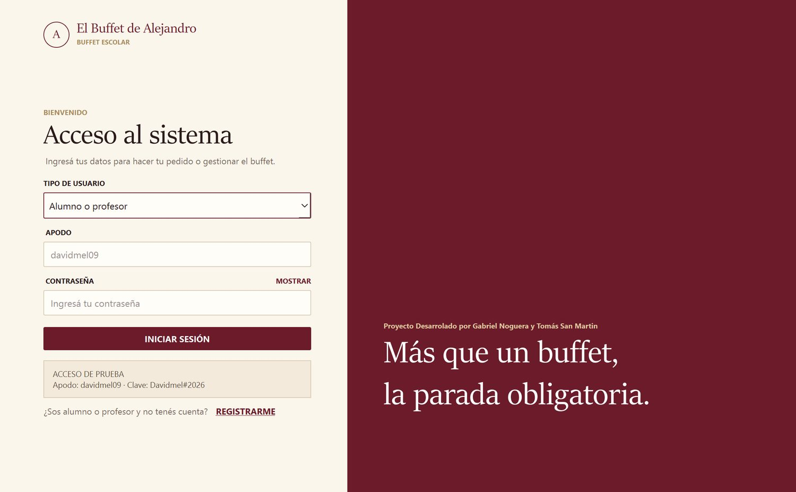
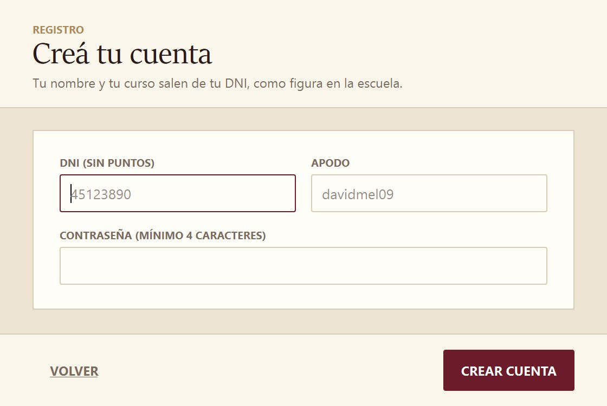
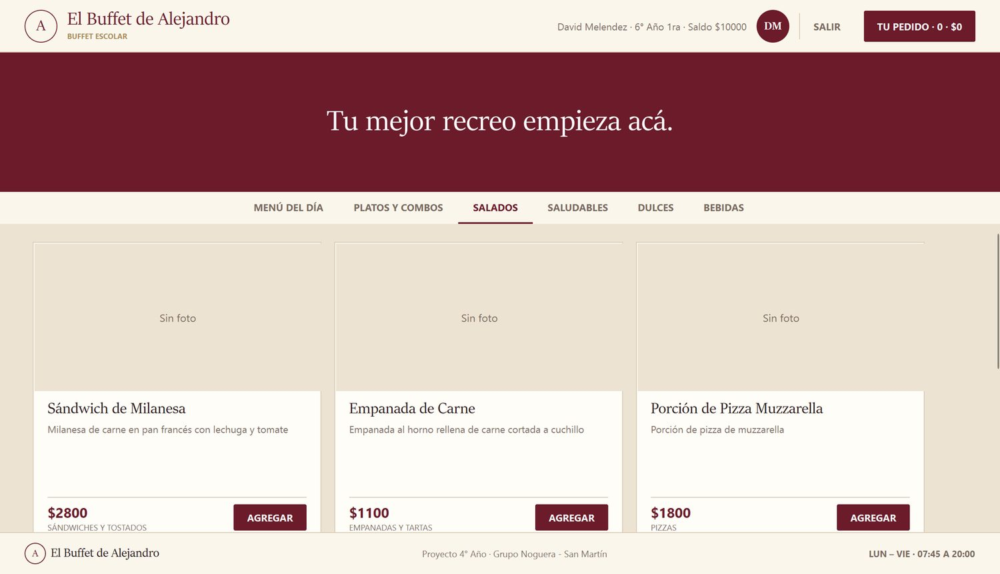
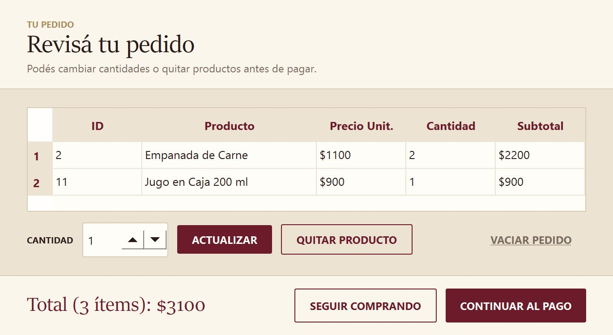
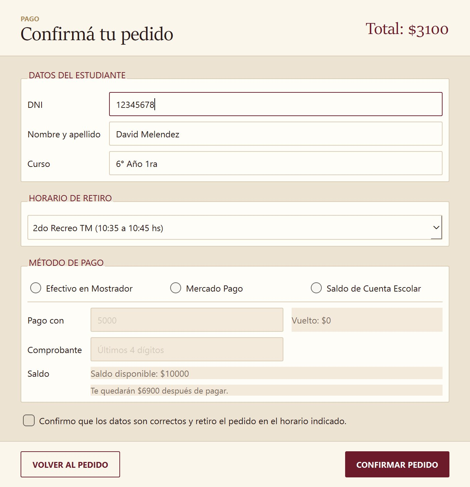
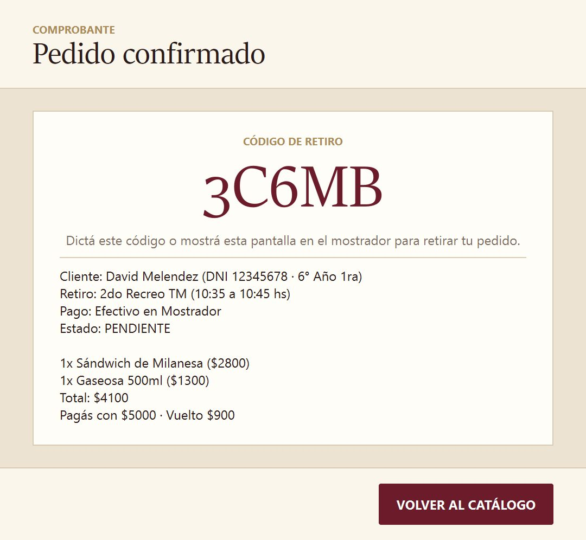
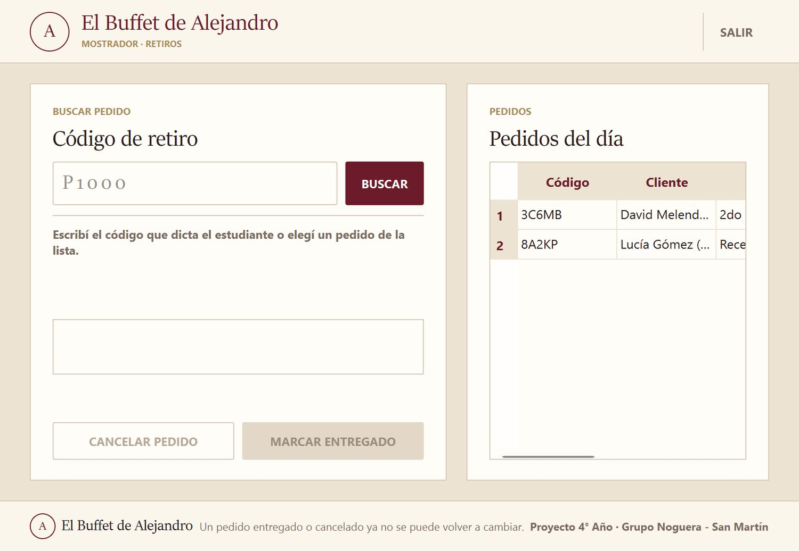
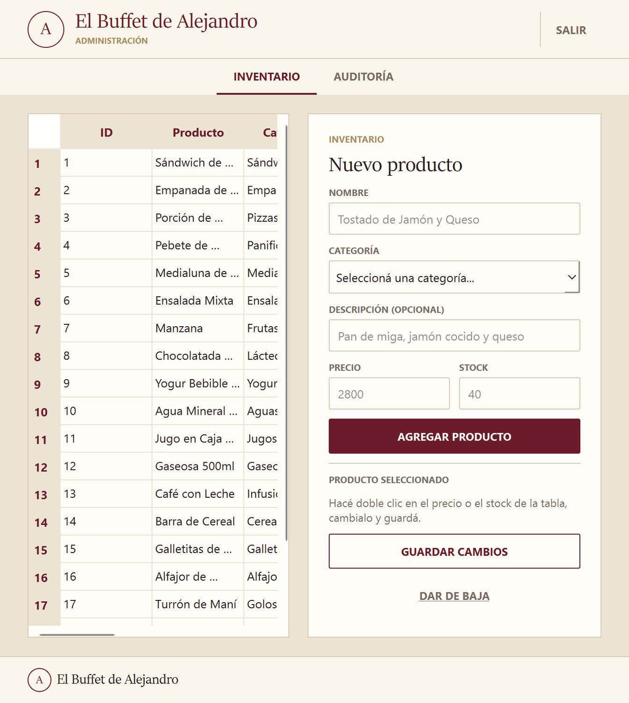

# 1. Qué es El Buffet de Alejandro

Es un sistema **Click & Collect** para el buffet de la escuela. El estudiante (o el profesor) arma su pedido desde la aplicación, lo paga y recibe un **código de retiro de 5 caracteres** (por ejemplo `3C6MB`). En el recreo siguiente dicta ese código en el mostrador y retira el pedido sin hacer la fila de compra.

La aplicación tiene cuatro perfiles. Cada uno entra con sus propias credenciales y ve solo sus pantallas:

| Perfil | Para qué lo usa | Qué necesita para entrar |
|---|---|---|
| Estudiante o profesor | Ver el menú, armar el pedido, pagar y obtener el código | Apodo y contraseña |
| Personal de caja | Buscar el código, entregar o cancelar pedidos | Apodo, contraseña y PIN de 4 dígitos |
| Administración | Cargar productos, cambiar precio y stock, ver la auditoría | Apodo y contraseña del encargado |
| Desarrollador | Revisar los stored procedures y las pruebas, abrir cualquier vista | Apodo, contraseña y token de acceso |

# 2. Antes de empezar

- La aplicación es un programa de escritorio para Windows (`ElBuffetDeAlejandro.exe`). Se abre con doble clic.
- Al abrirse se conecta con la base de datos MySQL del buffet. Si el servidor no está encendido aparece el aviso **"Sin conexión"**: la aplicación funciona igual con datos de ejemplo, pero **no guarda nada**. En ese caso avisá a soporte técnico antes de tomar pedidos reales.
- Los botones grises están deshabilitados: se habilitan cuando la acción es posible (por ejemplo, "Marcar entregado" solo con un pedido pendiente seleccionado).

## Usuarios de prueba

Para la demostración están cargados estos usuarios (también aparecen en la pantalla de inicio al elegir cada perfil):

| Perfil | Apodo | Contraseña | PIN o token |
|---|---|---|---|
| Estudiante | `davidmel09` | `Davidmel#2026` | (no usa) |
| Personal de caja | `marcela.ibanez` | `MarcelaBuffet#2026` | PIN `1234` |
| Administración | `alejandro.funes` | `AlejandroBuffet#2026` | (no usa) |
| Desarrollador | `soporte.dev` | `SoporteDev#2026` | Token `DEV-BEREA-2026` |

# 3. Iniciar sesión

1. En **TIPO DE USUARIO**, elegí con qué perfil entrás: *Alumno o profesor*, *Personal de buffet (caja)*, *Administrador* o *Desarrollador*. Los campos cambian según el perfil.
2. Escribí tu **apodo** y tu **contraseña**. Con el botón **MOSTRAR** ves lo que escribiste; con **OCULTAR** lo volvés a tapar.
3. Si sos personal de caja, completá también el **PIN** de 4 dígitos. Si sos desarrollador, el **token** de acceso.
4. Tocá **INICIAR SESIÓN** o apretá Enter.

**Reglas que conviene saber:**

- La contraseña tiene que tener al menos 4 caracteres.
- Tenés que entrar con el perfil que te corresponde. Un estudiante que elige "Administración" no entra aunque la contraseña sea correcta.
- Después de **3 intentos fallidos** la pantalla se bloquea. Cerrá la aplicación y volvé a abrirla. Cada intento fallido queda registrado en la auditoría.

# 4. Registrarse (estudiantes y profesores)

Solo pueden registrarse personas que ya figuran en la escuela como estudiantes o profesores. El personal del buffet no se registra: su usuario lo carga la escuela.

1. En el inicio de sesión, con el perfil *Alumno o profesor*, tocá **REGISTRARME** (debajo de "¿Sos alumno o profesor y no tenés cuenta?"). La aplicación también te lo ofrece si tu apodo o contraseña no coinciden.
2. Escribí tu **DNI** sin puntos (7 u 8 números).
3. Elegí un **apodo** (es tu nombre de usuario) y una **contraseña** de al menos 4 caracteres.
4. Tocá **CREAR CUENTA**.

Tu nombre y tu curso no se escriben: salen de tu DNI, como figura en la escuela. Si sos profesor, la cuenta queda con el rol Profesor y en tus datos aparece "Docente".

| Mensaje | Qué significa | Qué hacer |
|---|---|---|
| DNI Inválido | El DNI no es de ningún estudiante ni profesor de la escuela | Revisá el número. Si está bien, pedí que te den de alta en secretaría |
| DNI Registrado | Ese DNI ya tiene una cuenta | Iniciá sesión con el apodo que creaste |
| Apodo Ocupado | Otra persona ya usa ese apodo | Elegí otro |

# 5. Estudiante o profesor: hacer un pedido

## 5.1 El catálogo

Arriba ves tu nombre, tu curso y tu **saldo de cuenta escolar**. A la derecha, el círculo con tus iniciales abre tu perfil y **SALIR** cierra la sesión.

Los productos están separados en pestañas:

| Pestaña | Qué tiene |
|---|---|
| MENÚ DEL DÍA | El plato del día, con lo que incluye, el precio y cuántos quedan |
| PLATOS Y COMBOS | Platos calientes y combos |
| SALADOS | Sándwiches, empanadas, pizza, pebete |
| SALUDABLES | Ensalada, fruta, frutos secos, barra de cereal |
| DULCES | Medialunas, alfajores, galletitas, turrón |
| BEBIDAS | Agua, jugo, gaseosa, chocolatada, yogur, café con leche |

El **menú del día** es fijo para cada día de la semana: lunes tarta de choclo, martes tortilla de papas, miércoles milanesa de pollo con puré, jueves fideos con tuco y viernes ravioles. Sábado y domingo no hay menú y el botón queda deshabilitado.

## 5.2 Agregar productos al carrito

1. Tocá **AGREGAR** en el producto que quieras. Se abre el detalle con la foto, la descripción y el precio.
2. Con **+** y **−** elegí la cantidad. El total se actualiza solo.
3. Tocá **AGREGAR AL PEDIDO**.

Límites de cada producto:

- Como mínimo 1 unidad y como máximo **10 unidades por producto** en un mismo pedido.
- No podés pedir más de lo que queda en stock. Si ya tenés unidades en el carrito, se descuentan del máximo.

El botón de abajo, **TU PEDIDO · cantidad · $total**, muestra en todo momento cuántos productos llevás y cuánto suman.

## 5.3 Revisar el carrito

Tocá **TU PEDIDO**. Si el carrito está vacío, la aplicación te avisa y no abre nada.

En la tabla ves cada producto con su precio, cantidad y subtotal. Desde acá podés:

- **Cambiar una cantidad:** seleccioná la fila, elegí la nueva **CANTIDAD** (de 1 a 10) y tocá **ACTUALIZAR**.
- **Quitar un producto:** seleccioná la fila y tocá **QUITAR PRODUCTO**. Te pide confirmación.
- **Vaciar todo:** **VACIAR PEDIDO**, también con confirmación.
- **SEGUIR COMPRANDO:** volvés al catálogo sin perder lo que elegiste.
- **Ir al pago:** **CONTINUAR AL PAGO**.

## 5.4 Pagar

1. Revisá tus datos (DNI, nombre y curso). Se completan solos.
2. Mirá el **horario de retiro**. No se elige: siempre es el recreo que sigue (ver la tabla de abajo).
3. Elegí el **método de pago**:
   - **Efectivo en mostrador:** escribí con cuánto vas a pagar. La aplicación calcula el vuelto, o cuánto falta si el monto no alcanza.
   - **Mercado Pago:** escribí los **4 últimos dígitos** del comprobante de la transferencia.
   - **Saldo de cuenta escolar:** se descuenta de tu saldo. La pantalla te dice cuánto te queda o si no alcanza.
4. Marcá la casilla **"Confirmo que los datos son correctos y retiro el pedido en el horario indicado"**.
5. Tocá **CONFIRMAR PEDIDO**.

### Horario de pedidos

Los pedidos se hacen **de un recreo para el siguiente**:

| Si pedís… | Retirás en… |
|---|---|
| De 06:00 a 07:45, antes de entrar | 1er Recreo TM (09:00 a 09:15) |
| Durante el 1er Recreo TM | 2do Recreo TM (10:35 a 10:45) |
| Durante el 2do Recreo TM | Almuerzo (12:05 a 13:30) |
| Durante el Almuerzo | 1er Recreo TT (14:50 a 15:00) |
| Durante el 1er Recreo TT | 2do Recreo TT (16:20 a 16:30) |
| Durante el 2do Recreo TT | Atención Post-Clases (17:50 a 20:00) |

En **horario de clases** podés mirar el catálogo y armar el carrito, pero al confirmar aparece el aviso **"Horario de clases"** y el pedido no se toma.

## 5.5 El comprobante y el código de retiro

Al confirmar aparece el comprobante con el **código de 5 caracteres** en grande, el detalle del pedido, el recreo de retiro y el método de pago (si pagás en efectivo, también con cuánto pagás y el vuelto).

**Dictá ese código o mostrá la pantalla en el mostrador.** El código sirve una sola vez: cuando el cajero entrega el pedido, deja de valer. **VOLVER AL CATÁLOGO** cierra el comprobante; el código queda guardado en tu perfil.

## 5.6 Mi perfil: saldo e historial

Tocá el círculo con tus iniciales.

- **Saldo de cuenta escolar:** muestra cuánto tenés disponible. Para cargar, escribí el **monto** (de $1 a $50.000) y los **4 últimos dígitos del comprobante de Mercado Pago**, y tocá **CARGAR SALDO**. El saldo nuevo aparece al instante.
- **Mis pedidos:** la lista de tus pedidos, del más nuevo al más viejo, con su código, estado (PENDIENTE, ENTREGADO o CANCELADO), total, recreo de retiro y método de pago. Si perdiste el comprobante, el código está acá.

**VOLVER AL CATÁLOGO** cierra el perfil.

# 6. Personal de caja: entregar pedidos

A la derecha está la lista **Pedidos del día** con el código, el cliente, el recreo, el total y el estado de cada pedido.

1. Escribí el **código** que te dicta el estudiante (las minúsculas pasan a mayúsculas solas) y tocá **BUSCAR**. También podés tocar un pedido de la lista.
2. Revisá el detalle: cliente, DNI, curso, recreo, método de pago, productos y total. Si paga en efectivo, también ves con cuánto paga y el vuelto.
3. Entregá el pedido y tocá **MARCAR ENTREGADO**.

Si hay que anular el pedido (por ejemplo, el estudiante no lo quiere o falta un producto), tocá **CANCELAR PEDIDO**. Al cancelar, el sistema **devuelve el stock** de los productos y, si se pagó con saldo de cuenta escolar, **devuelve el saldo** al estudiante.

**Reglas:**

- Solo se puede entregar o cancelar un pedido **PENDIENTE**. Un pedido entregado o cancelado ya no se puede cambiar, y los botones quedan deshabilitados. Así se evita entregar dos veces el mismo pedido.
- Si el código no existe, aparece "No hay ningún pedido con el código …". Pedile al estudiante que lo revise en su perfil.
- Cada entrega y cada cancelación queda registrada en la auditoría con tu usuario.

# 7. Administración: productos y auditoría

## 7.1 Inventario

La tabla muestra todos los productos con su ID, nombre, categoría, precio, stock y estado (Activo o Inactivo).

**Agregar un producto:**

1. Completá **nombre**, **categoría**, **precio** y **stock**. La descripción es opcional.
2. Tocá **AGREGAR PRODUCTO**.

La categoría es obligatoria. El precio tiene que ser un número entero mayor a 0 y el stock un entero mayor o igual a 0. Revisá en la tabla que el producto no esté cargado antes de agregarlo.

**Cambiar precio o stock:**

1. Hacé doble clic en la celda del precio o del stock y escribí el valor nuevo.
2. Con la fila seleccionada, tocá **GUARDAR CAMBIOS**.

**Dar de baja un producto:** seleccioná la fila y tocá **DAR DE BAJA**. El producto queda **Inactivo** (no se borra, para no perder las ventas viejas que lo incluyen).

## 7.2 Auditoría

La pestaña **AUDITORÍA** muestra los últimos 50 eventos del sistema, del más nuevo al más viejo: usuario, tipo de evento y detalle. Quedan registrados, entre otros:

- inicios y cierres de sesión, y los intentos fallidos;
- registros de usuarios nuevos;
- ventas, productos y menús agregados al carrito, y códigos de retiro generados;
- entregas y cancelaciones de pedidos;
- altas y bajas de productos, y cambios de precio y de stock;
- cargas de saldo.

# 8. Desarrollador: consola técnica

Es la pantalla de soporte técnico. Tiene tres pestañas:

- **STORED PROCEDURES:** la lista de los 27 procedimientos de la base de datos. Al elegir uno se ve su firma y su código. En **valores de los parámetros** se escriben separados por coma, con los textos entre comillas (por ejemplo `1, 5000`). **GENERAR CALL** arma la llamada, la ejecuta y muestra las primeras 15 filas que devuelve.
- **PRUEBAS:** las 28 pruebas del script 06, cada una con sus cuatro casos (éxito, sin coincidencias, parámetros nulos o límite, y consistencia).
- **VISTAS:** abre la pantalla de Estudiante, Mostrador o Administración, para revisarlas sin cambiar de usuario.

Los procedimientos se ejecutan sobre la base real: un `CALL` que modifica datos (por ejemplo `sp_cargar_saldo`) los modifica de verdad.

# 9. Cerrar sesión

En todas las pantallas, el botón **SALIR** cierra la sesión, lo deja registrado en la auditoría y vuelve al inicio de sesión. Si la computadora la usa más de una persona, cerrá siempre la sesión al terminar.

# 10. Problemas frecuentes

| Problema | Causa | Solución |
|---|---|---|
| Aparece "Sin conexión" al abrir | El servidor MySQL no está encendido | Avisá a soporte técnico. Sin conexión no se guarda ningún pedido |
| "Bloqueado: superó el límite de 3 intentos" | Tres intentos fallidos seguidos | Cerrá y volvé a abrir la aplicación, y revisá el perfil elegido |
| "Acceso denegado" con la contraseña correcta | Elegiste un perfil que no es el tuyo | Elegí el perfil correcto (por ejemplo Estudiante en lugar de Administración) |
| "Horario de clases" al confirmar | Estás fuera de las ventanas de pedido | Pedí antes de las 07:45 o durante un recreo |
| "Saldo insuficiente" | El saldo no cubre el total | Cargá saldo desde tu perfil o elegí otro método de pago |
| "Sin stock" al confirmar | Otro estudiante compró las últimas unidades mientras armabas el pedido | Bajá la cantidad o quitá el producto del carrito |
| "Comprobante inválido" | No escribiste exactamente 4 dígitos | Copiá los 4 últimos números del comprobante de Mercado Pago |
| El botón del menú del día está gris | Es sábado o domingo, o se agotó | Elegí otro producto |
| El cajero no puede entregar | El pedido ya figura ENTREGADO o CANCELADO | Revisá el estado en la lista. Un pedido cerrado no se puede cambiar |
